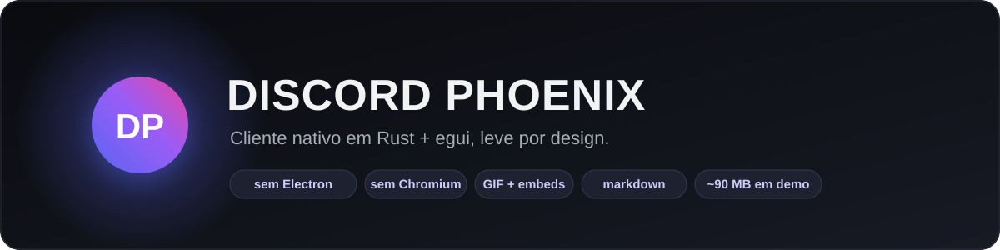
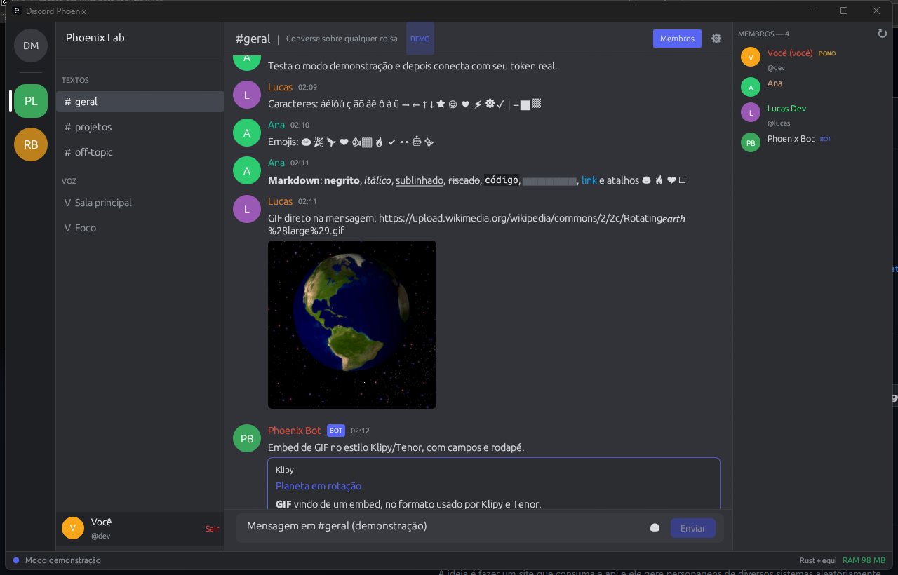
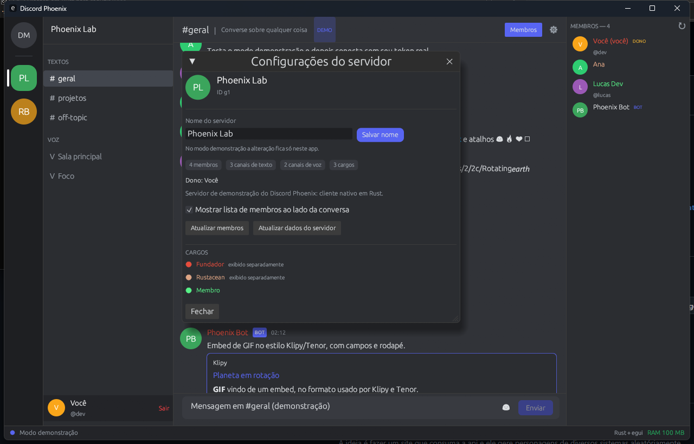
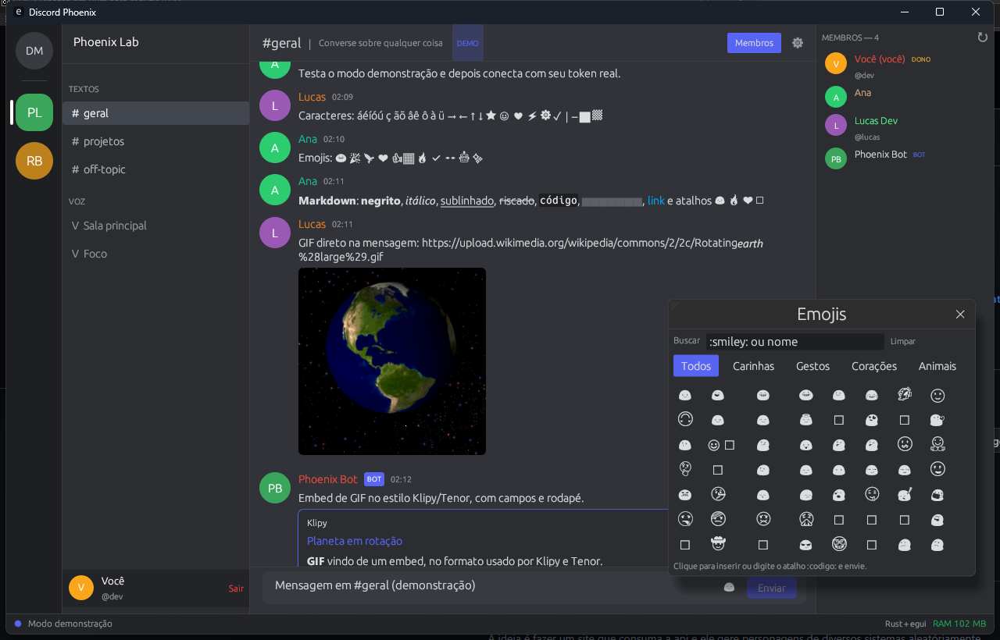
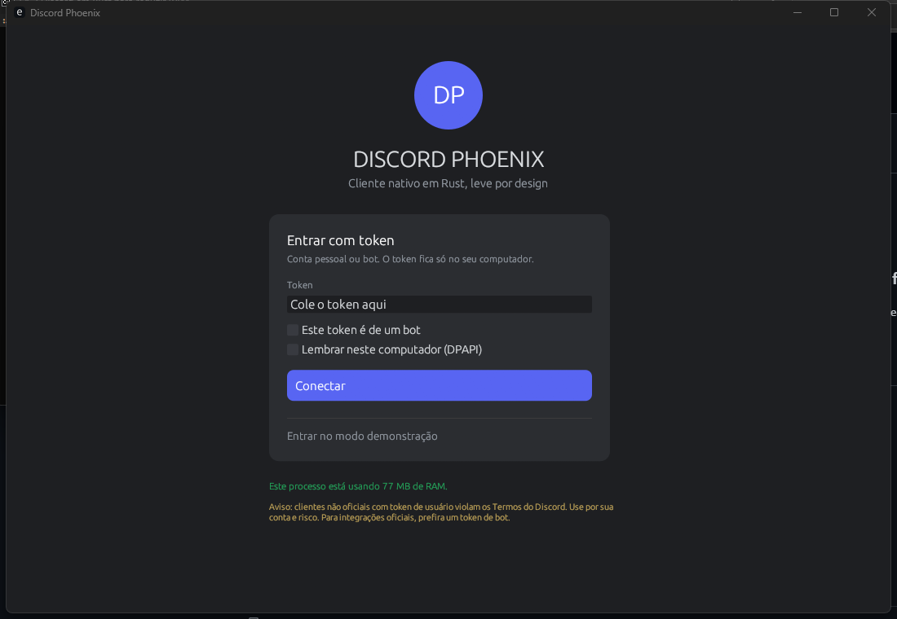

<p align="center">
  
</p>

<p align="center">
  <a href="https://www.rust-lang.org/"></a>
  
  
  
</p>

<h1 align="center">Discord Phoenix</h1>

<p align="center">
  Um cliente Discord <strong>nativo</strong>, escrito em <strong>Rust + egui</strong>.<br>
  Sem Electron, sem Chromium embutido, sem Node.js — a interface é desenhada direto pela GPU.
</p>

---

## Por que o Phoenix?

O cliente oficial carrega um navegador inteiro junto. O Phoenix não: ele fala
HTTP e WebSocket com o Discord e desenha a interface com o egui. O resultado é
um processo enxuto, que abre rápido e fica na casa dos **90 MB de RAM** no modo
demonstração — enquanto clientes baseados em Electron costumam passar de
300 MB.

- **Nativo de verdade:** binário único, sem runtime web.
- **Leve por design:** cache de mídia com limites de tamanho, quadros e entradas.
- **Feito para Windows:** DPAPI para o token, fontes do sistema e correção de
  AltGr/Alt Code para teclados ABNT2.
- **Modo demonstração:** explore a interface inteira sem token e sem login.

## Prints

<p align="center">
  
</p>

<p align="center"><em>Servidores, canais, DMs, markdown, GIFs, embeds e lista de membros na mesma tela.</em></p>

| Configurações do servidor | Seletor de emojis |
|:---:|:---:|
|  |  |
| Nome, dono, contagem, cargos e atualização de dados. | Busca por nome/atalho e grupos de emojis. |

<p align="center">
  
</p>

<p align="center"><em>Login com token de conta ou bot, com armazenamento seguro via DPAPI.</em></p>

## O que já está funcional

### Autenticação e sessão

- [x] Login com **token de conta** ou **token de bot**.
- [x] Detecção automática do prefixo `Bot ` no token.
- [x] Token salvo com **DPAPI** do Windows (`%APPDATA%\DiscordPhoenix`), nunca em texto puro.
- [x] Logout limpa a sessão e o token persistido.
- [x] Sessão restaurada automaticamente ao abrir o app.

### Servidores, canais e DMs

- [x] Lista de servidores com ícones reais (ou iniciais coloridas).
- [x] Canais de texto organizados por categoria e posição.
- [x] Canais de voz listados (somente leitura nesta versão).
- [x] Mensagens diretas com avatar, nome e indicador de não lida.
- [x] Contador de não lidas e rascunho por canal.
- [x] Indicador de “está digitando…”, status da conexão e ping do gateway.

### Mensagens em tempo real

- [x] Histórico de mensagens ao abrir um canal.
- [x] Envio com **Enter** e quebra de linha com **Shift+Enter**.
- [x] Edição e exclusão das próprias mensagens (menu de contexto).
- [x] Recebimento em tempo real via **Discord Gateway v10**.
- [x] Heartbeat, reconexão automática e tratamento de intents.
- [x] Mensagens editadas atualizam conteúdo, anexos e embeds.

### Mídia

- [x] Avatares de usuários e ícones de servidor.
- [x] Anexos **PNG, JPEG, GIF e WebP** renderizados na conversa.
- [x] **GIFs animados** e **WebP animados** decodificados no cliente.
- [x] URLs diretas de imagem/GIF no texto também viram mídia.
- [x] Embeds com cor, autor, título, descrição, campos, imagem, miniatura e rodapé.
- [x] Miniaturas de GIFs do **Klipy/Tenor** exibidas dentro dos embeds.
- [x] Clique na mídia abre o original no navegador.
- [x] Cache LRU com limite de entradas, quadros e resolução para segurar a RAM.

### Formatação e emojis

- [x] Markdown do Discord em widgets nativos (sem HTML/WebView):
  `**negrito**`, `*itálico*`, `__sublinhado__`, `~~riscado~~`, `` `código` ``,
  blocos de código, citações, listas, títulos, subtexto, spoilers e links.
- [x] Emojis Unicode com fontes de fallback do Windows.
- [x] Atalhos tradicionais como `:smiley:`, `:fire:` e `:heart:` convertidos no envio.
- [x] Seletor de emojis com busca, grupos e mais de 250 atalhos.
- [x] Links abrem no navegador e spoilers são revelados com clique.

### Servidor e membros

- [x] **Painel de membros** ao lado da conversa, com avatar e nome.
- [x] Cores de cargo aplicadas ao nome do membro.
- [x] Badges de **DONO** e **BOT**.
- [x] Botão para mostrar/esconder e atualizar a lista.
- [x] **Configurações do servidor:** nome, ID, dono, descrição, contagem de
  membros, canais, cargos e status.
- [x] Renomear servidor pela interface (quando a conta tem permissão).
- [x] Atualização de dados do servidor e de membros sob demanda.

### Extras

- [x] Modo demonstração completo, sem token e sem login.
- [x] Consumo de RAM exibido em tempo real na barra de status.
- [x] Correção local do **AltGr/Ctrl+Alt** no `egui-winit` para ABNT2.
- [x] Fontes do Windows para acentos, símbolos e Alt Codes.
- [x] 18 testes automatizados (modelo, markdown, emojis, imagens, DPAPI e fontes).

## Em desenvolvimento / roadmap

### Curto prazo

- [ ] Paginação do histórico (scroll infinito) em vez de apenas as 50 últimas.
- [ ] Scroll de membros com paginação para servidores grandes.
- [ ] Emojis personalizados renderizados inline (hoje aparecem como `:nome:`).
- [ ] Stickers e GIFs escolhidos por um seletor integrado (Klipy).
- [ ] Menções a usuários, canais e cargos clicáveis.
- [ ] Respostas, reações e enquetes.

### Médio prazo

- [ ] Threads, fóruns e canais de anúncio.
- [ ] Busca de mensagens.
- [ ] Notificações nativas e bandeja do sistema.
- [ ] Múltiplas contas e troca rápida de perfil.
- [ ] Temas e atalhos configuráveis.
- [ ] Destaque de sintaxe nos blocos de código.
- [ ] Upload de arquivos e pré-visualização antes de enviar.

### Longo prazo

- [ ] Voz e vídeo (WebRTC), incluindo compartilhamento de tela.
- [ ] Gerenciamento completo de cargos, canais e permissões.
- [ ] Instalador, atualização automática e assinatura do executável.
- [ ] Suporte a Linux e macOS (o núcleo já é multiplataforma; DPAPI e fontes são específicos do Windows).

## Limitações conhecidas

- **Windows 10/11 apenas** nesta versão.
- **Sem voz, vídeo ou compartilhamento de tela.**
- O markdown cobre o subconjunto mais usado, não a especificação inteira.
- Emojis personalizados aparecem como texto (`:nome:`), não como imagem.
- GIFs animados são limitados a **16 quadros** e **240×240 px**; imagens
  estáticas a **400×320 px**. É intencional para manter o consumo baixo.
- A lista de membros usa a API REST (até 1000 membros) e não mostra presença
  online/offline em tempo real.
- Embeds do tipo `gifv` que só oferecem MP4 são exibidos pela miniatura; o
  vídeo MP4 não é reproduzido.
- Anexos que não são imagem aparecem como link.
- Não há notificações nativas nem suporte a múltiplas contas simultâneas.

## Como rodar

### Requisitos

- Windows 10/11.
- [Rust estável](https://rustup.rs/) (testado com rustc 1.99).
- Visual Studio Build Tools com o workload **Desktop development with C++**.
- Conexão com a internet para falar com o Discord.

### Compilar

```powershell
cd "D:\Discord Phoenix"
cargo build --release
```

O executável fica em `target\release\DiscordPhoenix.exe`.

Ou use os scripts:

```powershell
.\build.ps1   # compila e copia para dist\DiscordPhoenix.exe
.\run.ps1     # executa (compila se necessário)
```

### Modo demonstração

```powershell
$env:PHOENIX_DEMO = "1"
.\target\release\DiscordPhoenix.exe
```

O modo demonstração não lê token nem acessa sua conta. As imagens de exemplo
são baixadas de URLs públicas.

### Entrar com sua conta

1. Abra o aplicativo.
2. Cole o token de conta ou de bot.
3. Marque **“Este token é de um bot”** se for o caso.
4. Marque **“Lembrar neste computador (DPAPI)”** para persistir a sessão.
5. Clique em **Conectar**.

## Arquitetura

| Módulo | Responsabilidade |
|---|---|
| `src/main.rs` | Ponto de entrada e configuração da janela nativa. |
| `src/ui.rs` | Toda a interface egui: rail, canais, chat, membros, configurações, emojis e compositor. |
| `src/worker.rs` | Ator assíncrono que executa comandos de rede e envia eventos para a UI. |
| `src/api.rs` | Cliente REST do Discord (guilds, canais, mensagens, membros). |
| `src/gateway.rs` | WebSocket do Gateway v10, heartbeat e dispatch de eventos. |
| `src/model.rs` | Estruturas de usuário, servidor, cargo, membro, canal, embed e mensagem. |
| `src/images.rs` | Download, cache LRU, decodificação e animação de PNG/JPEG/GIF/WebP. |
| `src/markdown.rs` | Parser e renderer nativo do markdown do Discord. |
| `src/emoji.rs` | Tabela de atalhos, busca e seletor de emojis. |
| `src/theme.rs` | Tema escuro, fontes do Windows e famílias bold/italic. |
| `src/config.rs` | Configurações e token protegido com DPAPI. |
| `src/demo.rs` | Dados locais do modo demonstração. |
| `vendor/egui-winit` | Patch local do AltGr/Ctrl+Alt para Windows. |

### Notas técnicas

- Interface: `eframe` / `egui 0.29` com renderer `glow`.
- Rede: `tokio`, `reqwest` e `tokio-tungstenite`.
- Imagens: `image` e `image-webp` (para animação WebP, que o crate `image` não expõe).
- O cache de mídia tem limite de **80 entradas** e falhas são memorizadas para
  evitar downloads repetidos.
- O token é cifrado com `CryptProtectData` (DPAPI) e nunca é impresso em log.
- O patch do `egui-winit` mantém o texto quando **Ctrl+Alt** estão pressionados,
  que é como o Windows reporta o AltGr em teclados ABNT2.

## Privacidade e segurança

- Nenhuma telemetria, analytics ou servidor intermediário.
- O token fica somente no seu computador, protegido pelo DPAPI do Windows.
- Os prints deste README foram feitos no **modo demonstração**, sem conta real.
- O app nunca imprime o token no terminal.

## Aviso importante

Usar um **token de conta** em clientes não oficiais viola os Termos de Serviço
do Discord e pode resultar em bloqueio da conta. Use por sua conta e risco.
Para integrações oficiais, prefira um **token de bot**. Este projeto não é
afiliado, associado ou endossado pela Discord Inc.

## Licença

MIT — veja [LICENSE](LICENSE).

<p align="center">
  Feito com 🦀 Rust e ☕ pela comunidade.
</p>
